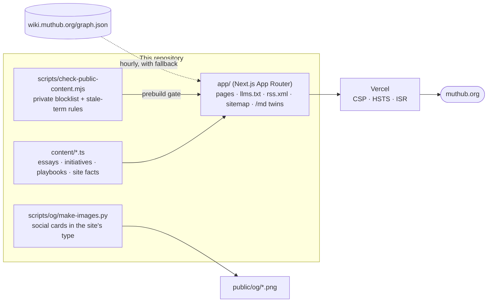

# muthub.org

**The essays, initiatives and playbooks of Muthukrishnan (Muthu) Bommiah on governed enterprise AI, built to be read
by people and by agents.**

[](https://github.com/muthub-ai/muthu-v0-portfolio-website/actions/workflows/ci.yml)
[](https://github.com/muthub-ai/muthu-v0-portfolio-website/actions/workflows/weekly-links.yml)
[](LICENSE)
[](https://nextjs.org)

**Live:** [muthub.org](https://muthub.org) · **Knowledge graph:** [wiki.muthub.org](https://wiki.muthub.org) · **Replicate it:** [docs/plan](docs/plan/README.md) · **Decisions:** [docs/decisions](docs/decisions/README.md)

## What it is

| | |
|---|---|
| **For readers** | Essays and shorter notes in five themes (context engineering, governed AI, AI-native SDLC, data and AI platforms, leading AI change), initiatives written as case studies, practical playbooks, an AI-readiness self-assessment, search on `/` and Ctrl+K, dark mode |
| **For agents** | A Markdown twin of every page (`/<page>.md`, `noindex`), `/llms.txt`, RSS, sitemap, and schema.org JSON-LD (Person, ProfilePage, WebSite with search, Article) |
| **For trust** | Every number traces to a private master profile; dated sources; a content rule that no essay cites a source published after it; a private blocklist that fails the build if anything confidential appears |
| **Connected** | A "Graph" link and a home-page band that reads the Knowledge Foundation's `graph.json` hourly, without ever depending on it (ADR 015 in the knowledge repo) |

## Architecture



| Concern | How it is handled |
|---|---|
| Content model | Typed TypeScript content (`content/*.ts`): drafts and published pieces in one place, checked by `tsc` and content tests; no CMS to run |
| Agent readability | Every page has a Markdown twin and a JSON-LD record; `llms.txt` lists the canonical pages |
| Integrity | Content tests: ISO dates, nothing dated in the future, `updated` never before `published`, no forward citations, links resolve and never point forward, house structure, no em dashes |
| Confidentiality | `check-public-content.mjs` runs before every build with the private list (git-ignored locally, a secret in CI); never prints a match |
| Security | CSP allowing only this site, Vercel analytics and Microsoft Clarity; HSTS; `X-Frame-Options: DENY`; no email address anywhere on the site |
| Performance | Static generation, image optimisation (AVIF/WebP), hourly ISR on the home page only |

## Quickstart

```bash
pnpm install                 # pnpm 10
pnpm dev                     # http://localhost:3000 (drafts visible)
pnpm build                   # public-content check, then a production build (drafts hidden)
pnpm exec playwright test    # with `pnpm build && pnpm start` running
```

## Publishing an essay

1. Add it to the right `content/*.ts` file with `status: "draft"`; preview with `pnpm dev`.
2. When ready: `status: "published"`, `published: "YYYY-MM-DD"`; add any new time-sensitive source to
   `playwright/fixtures/source-dates.ts`.
3. `python3 scripts/og/make-images.py` for its social card.
4. Open a pull request; CI must be green; merging deploys.

More in [docs/plan/05-operations.md](docs/plan/05-operations.md).

## Repository map

| Path | What |
|---|---|
| `content/site.ts` | Name, tagline, bio, navigation, themes, social links |
| `content/essays*.ts`, `content/context-engineering.ts` | Essays and notes |
| `content/initiatives.ts`, `content/playbooks.ts`, `content/about.ts` | Case studies, playbooks, about, career, Now page |
| `app/` | Pages, `/llms.txt`, `/rss.xml`, `/sitemap.xml`, Markdown twins (`/md/...`) |
| `components/` | Header, footer, figures, search, assessment, the Knowledge Foundation band |
| `scripts/` | Public-content guardrail, link checker, social-card generator |
| `playwright/` | Content rules, feature and site tests, source-date fixtures |
| `docs/` | [CI](docs/ci.md), [decisions](docs/decisions/README.md), [replication plan](docs/plan/README.md) |

## Quality gates

Every pull request runs **types and content rules** (blocklist, `tsc`, content rules) and **build, end-to-end tests,
links** (production build, Playwright over every page, internal link check). External links are checked weekly. See
[docs/ci.md](docs/ci.md).

## Licence

Code: MIT ([LICENSE](LICENSE)). Writing: © Muthukrishnan Bommiah. Views are the author's own and do not represent his employer.
